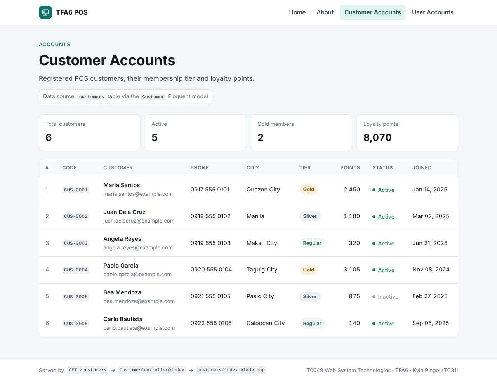
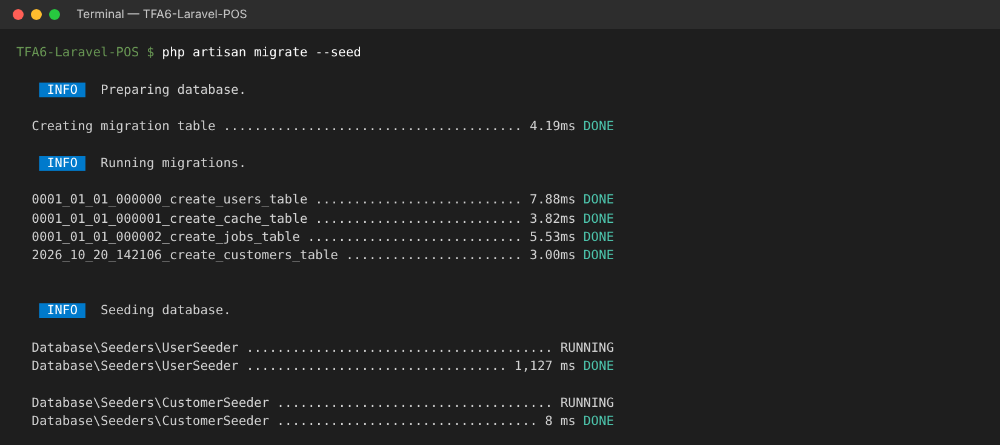
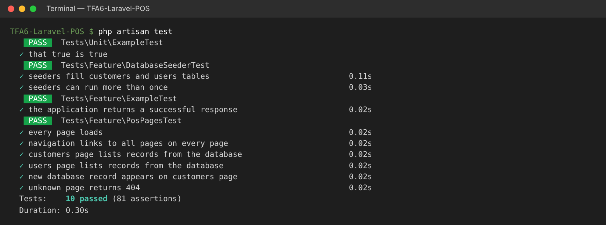

# TFA6 POS: From Arrays to Eloquent (Laravel)

**IT0049 Web System Technologies · Technical Formative Assessment 6**
Kyle Pingol · 202412274 · TC31 · Dr. Roman Villones

TFA6 rebuilds the [TFA5 POS](https://github.com/Kairu3452/TFA5-Laravel-POS) with a **real database**. The static PHP arrays in the controllers are gone. **Migrations** now create the tables, a **seeder** fills them with sample data, and the controllers read the records through **Eloquent models**. The schema matches TFA2.

- **Live site:** _LIVE_URL_
- **Repository:** https://github.com/Kairu3452/TFA6-Laravel-POS



---

## What changed from TFA5

| Step | TFA5 (static arrays) | TFA6 (database + Eloquent) |
|---|---|---|
| 1. Migrations | — | `customers` table (**full_name, email, phone** + POS fields) and `users` table (**username unique, full_name** + POS fields) |
| 2. Seeder | — | `CustomerSeeder` and `UserSeeder` insert **6 records each**. `DatabaseSeeder` calls both. |
| 3. Models | — | `App\Models\Customer` and `App\Models\User` (Eloquent) |
| 4. Controllers | `private static array $customers = [...]` | `Customer::orderBy('id')->get()` / `User::orderBy('id')->get()` |
| 5. Views | `$customer['name']` | `$customer->full_name` (same table layout as TFA5) |

```php
// app/Http/Controllers/CustomerController.php
public function index(): View
{
    $customers = Customer::orderBy('id')->get();

    $summary = [
        'total' => $customers->count(),
        'active' => $customers->where('status', 'Active')->count(),
        'gold' => $customers->where('tier', 'Gold')->count(),
        'points' => $customers->sum('points'),
    ];

    return view('customers.index', compact('customers', 'summary') + ['title' => 'Customer Accounts']);
}
```

```blade
{{-- resources/views/customers/index.blade.php --}}
@foreach ($customers as $customer)
    <tr>
        <td><code>{{ $customer->code }}</code></td>
        <td>{{ $customer->full_name }} <span>{{ $customer->email }}</span></td>
        <td>{{ $customer->phone }}</td>
        ...
    </tr>
@endforeach
```

## Migrations and seeders



## Database schema

**customers**: `id`, `code` (unique), `full_name`, `email` (unique), `phone`, `city`, `tier`, `points`, `status`, `joined`, `created_at`, `updated_at`

**users**: `id`, `username` (unique), `full_name`, `email` (unique), `role`, `status`, `last_login_at`, `email_verified_at`, `password`, `remember_token`, `created_at`, `updated_at`

## Files written for this activity

```
app/
  Http/Controllers/
    CustomerController.php    # Customer::orderBy('id')->get()
    UserController.php        # User::orderBy('id')->get()
    PageController.php        # home() and about()
  Models/
    Customer.php              # Eloquent model for customers
    User.php                  # Eloquent model for users
database/
  migrations/
    0001_01_01_000000_create_users_table.php      # users (username unique, full_name, ...)
    2026_10_20_142106_create_customers_table.php  # customers (full_name, email, phone, ...)
  seeders/
    DatabaseSeeder.php        # calls UserSeeder + CustomerSeeder
    UserSeeder.php            # 6 users
    CustomerSeeder.php        # 6 customers
  export/
    tfa6_pos.sql              # MySQL/MariaDB export (phpMyAdmin import)
  database.sqlite             # pre-seeded SQLite database used by the live site
resources/views/
  customers/index.blade.php   # loops over the Eloquent collection
  users/index.blade.php
tests/Feature/
  PosPagesTest.php            # pages render the Eloquent records
  DatabaseSeederTest.php      # migrations + seeders create 6 + 6 records
```

---

## Requirements

- PHP **8.2 or newer** (XAMPP 8.2.x works)
- [Composer](https://getcomposer.org/download/)
- XAMPP MySQL/MariaDB (or SQLite, see below)

## Setup and run locally

```bash
git clone https://github.com/Kairu3452/TFA6-Laravel-POS.git
cd TFA6-Laravel-POS

composer install
cp .env.example .env          # Windows CMD: copy .env.example .env
php artisan key:generate
```

### Create the tables and sample data

**Option A: XAMPP MySQL (default).** Start MySQL in the XAMPP Control Panel, then run:

```bash
php artisan migrate --seed    # answer "yes" if it offers to create the tfa6_pos database
php artisan serve
```

**Option B: SQLite (no MySQL needed).** In `.env` set `DB_CONNECTION=sqlite` and delete the other `DB_` lines. Then run `php artisan migrate --seed` and `php artisan serve`.

**Option C: phpMyAdmin.** Open http://localhost/phpmyadmin, go to **Import**, choose `database/export/tfa6_pos.sql`, and click **Import**.

Open **http://127.0.0.1:8000**. On Windows you can also double-click **`run-local.bat`**.

Re-create everything from scratch: `php artisan migrate:fresh --seed`

All seeded accounts use the demo password `password`.

## Artisan commands used

```bash
php artisan make:model Customer -m        # model + migration
php artisan make:seeder CustomerSeeder
php artisan make:seeder UserSeeder
php artisan migrate --seed
php artisan db:table customers
php artisan db:table users
php artisan route:list --except-vendor
php artisan test
php artisan serve
```

## Tests

```bash
php artisan test
```



The tests run the migrations and the seeder on an in-memory SQLite database. They check that every page loads, that the account pages receive an **Eloquent collection** of `Customer` / `User` models and show every seeded record, and that a new database row appears on the page.

## Deployment (Railway)

Deployed from this repository on [Railway](https://railway.com) with the Railpack builder (FrankenPHP). The live site uses the committed, pre-seeded `database/database.sqlite`. Service variables:

```
APP_NAME="TFA6 POS"
APP_ENV=production
APP_DEBUG=false
APP_KEY=base64:...            # php artisan key:generate --show
LOG_CHANNEL=stderr
DB_CONNECTION=sqlite
SESSION_DRIVER=file
CACHE_STORE=file
QUEUE_CONNECTION=sync
```
